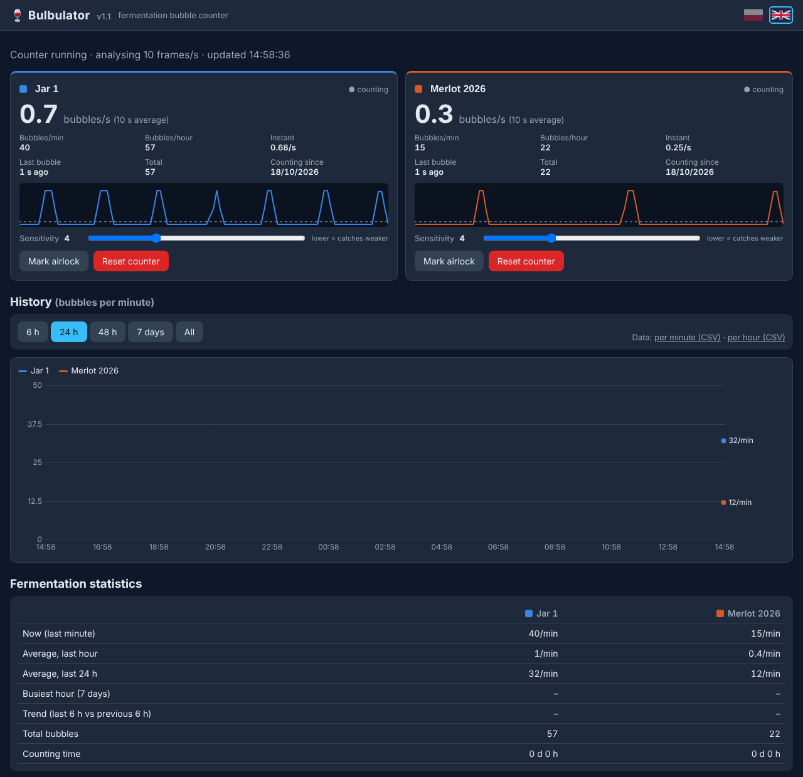

# 🍷 Bulbulator

**Fermentation airlock bubble counter for a webcam** — counts the bubbles in your wine or beer airlocks and shows live stats, history and trends on a web page.

[🇵🇱 Polska wersja](README.pl.md)



## Features

- Counts bubbles in **1–4 airlocks** at once, each with its own sensitivity
- Live view per airlock: bubbles/s, /min, /hour, instant rate, last bubble, total
- Live detection signal with the threshold line, for easy tuning
- History chart (6 h / 24 h / 48 h / 7 days / all) and CSV download
- Fermentation statistics: averages, busiest hour, trend (speeding up / slowing down)
- Mark the airlocks with the mouse directly on the camera image
- Polish and English interface (flags in the top-right corner)
- Light on resources: ~15% of one core on a Raspberry Pi 4 / RK3399 board

## How it works

The camera image is analysed ~15 times per second at half resolution. Inside each marked rectangle the program measures the change between consecutive frames, subtracts the change of the whole picture (light flicker, camera noise) and looks for short peaks. The threshold adapts by itself to the background noise of each airlock (median + MAD), and the *sensitivity* slider sets how far above the noise a peak has to be.

## Requirements

- Linux (Debian, Ubuntu, Raspberry Pi OS, Armbian…) with Python 3 and OpenCV
- A camera:
  - **MJPEG stream** (recommended): e.g. [ustreamer](https://github.com/pikvm/ustreamer), mjpg-streamer, or an IP camera with an MJPEG URL — the camera can then be used by other programs at the same time
  - or **a USB camera** read directly (`/dev/video0`)

## Quick start (try it without a camera)

```sh
sudo apt install python3-opencv python3-numpy
git clone https://github.com/myshak1/bulbulator.git
cd bulbulator
python3 tools/fake_stream.py 8090 &          # fake camera with two bubbling airlocks
BULBULATOR_STREAM=http://127.0.0.1:8090/stream \
BULBULATOR_HTTP=127.0.0.1:8088 \
BULBULATOR_DATA=./data BULBULATOR_STATE=./data \
python3 bulbulator.py
```

Open <http://127.0.0.1:8088/>, click **Mark airlock** on each card and drag a rectangle around each bright tube.

## Installation (runs as a service)

```sh
git clone https://github.com/myshak1/bulbulator.git
cd bulbulator
sudo ./install.sh
```

Then set your camera in `/etc/systemd/system/bulbulator.service` and restart:

```sh
sudo nano /etc/systemd/system/bulbulator.service
sudo systemctl daemon-reload && sudo systemctl restart bulbulator
```

The page is at `http://<your-device-ip>:8088/`.

### Settings (environment variables)

| Variable | Default | Meaning |
|---|---|---|
| `BULBULATOR_STREAM` | `http://127.0.0.1:8090/stream` | MJPEG URL, or a camera: `0` / `/dev/video0` |
| `BULBULATOR_JARS` | `2` | number of airlocks (1–4) |
| `BULBULATOR_HTTP` | *(off)* | built-in web server address, e.g. `0.0.0.0:8088` |
| `BULBULATOR_AUTH` | *(none)* | login for the built-in server, `user:password` |
| `BULBULATOR_DATA` | `/var/lib/bulbulator` | config, history and counters |
| `BULBULATOR_STATE` | `/run/bulbulator` | live state and snapshot (best in RAM) |
| `BULBULATOR_WEB` | `./web` | folder with `index.html` |
| `BULBULATOR_FPS` | `15` | analysed frames per second |

### Security

The built-in server has **no login by default** — set `BULBULATOR_AUTH` or bind it to `127.0.0.1` if your network is not trusted. For access from the internet put it behind nginx with HTTPS: see [`deploy/nginx-bulbulator.conf`](deploy/nginx-bulbulator.conf) (password-protected, served at `/bulbulator/`).

## Tips for accurate counting

- Keep the camera and jars **still**, use **steady light** (an LED lamp, no sunlight moving across the tubes).
- A **dark background** behind the airlock and the rectangle covering **only the airlock with water** give the clearest peaks.
- Watch the small chart under each counter: every bubble should be a peak above the dashed line. Bubbles missed → lower that airlock's sensitivity. Counting too many → raise it.
- Count by hand for one minute and compare with *Bubbles/min*.
- Three-piece airlocks (with a floating cap) are the easiest to detect.

## Files

| Path | Content |
|---|---|
| `DATA/config.json` | airlock areas, names, sensitivity (written by the page) |
| `DATA/historia_min.csv` | `unix_time,count1,count2,…` per minute (last 48 h) |
| `DATA/historia_godz.csv` | the same per hour (whole history) |
| `DATA/liczniki.json` | total counters |
| `STATE/stan.json`, `STATE/snapshot.jpg` | live state and camera image for the page |

File and JSON key names are Polish (*gąsior* = carboy, *bąbel* = bubble).

## License

[MIT](LICENSE)
