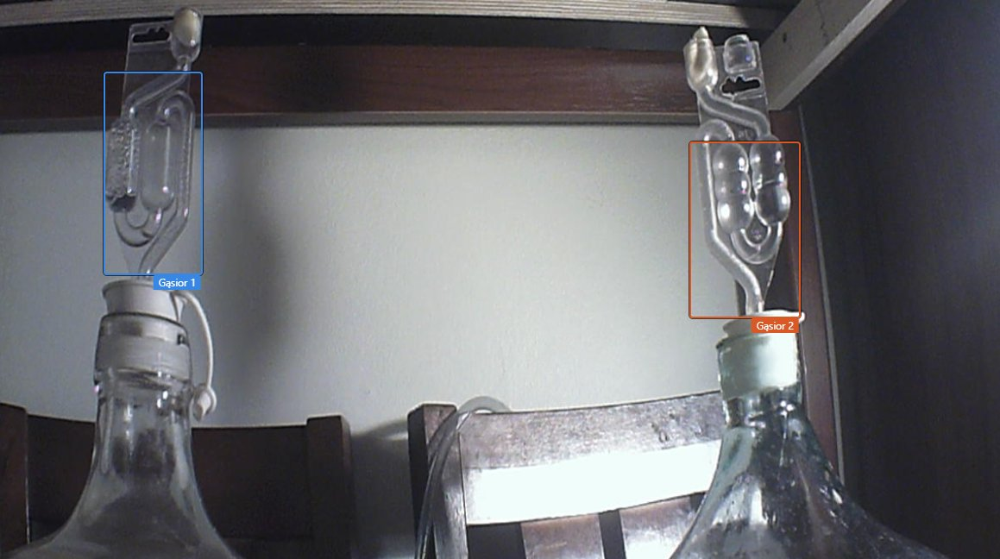

# 🍷 Bulbulator

**Licznik bąbli w rurkach fermentacyjnych z kamery.** Liczy bąble w rurkach gąsiorów z winem lub piwem i pokazuje na stronie statystyki na żywo, historię i trend fermentacji.

[🇬🇧 English version](README.md)



*Dwa gąsiory z winem obserwowane przez Bulbulatora — kolorowe prostokąty to obszary rurek zaznaczone na stronie.*


## Możliwości

- Liczenie bąbli w **1–4 rurkach** naraz, każda z własnym **stałym progiem**, który zmieniasz tylko Ty
- Na żywo dla każdej rurki: bąbli/s, /min, /godz., tempo chwilowe, ostatni bąbel, suma
- Wykres sygnału wykrywania z linią progu: kliknij albo przeciągnij na nim, żeby ustawić próg
- Wykres historii (6 h / 24 h / 48 h / 7 dni / całość) i pobieranie CSV
- Statystyki fermentacji: średnie, najaktywniejsza godzina, trend (przyspiesza / zwalnia)
- Obraz z kamery na żywo na górze strony; ramka rurki miga przy każdym policzonym bąblu
- Zaznaczanie rurek myszą bezpośrednio na obrazie z kamery
- Przycisk **Nowa fermentacja**: liczniki i historia zaczynają się od zera, stare dane zostają w archiwum CSV
- Interfejs po polsku i po angielsku (flagi w prawym górnym rogu)
- Małe obciążenie: ok. 15% jednego rdzenia na Raspberry Pi 4 i płytkach z RK3399

## Jak to działa

Obraz z kamery jest analizowany ok. 15 razy na sekundę w połowie rozdzielczości. W każdym zaznaczonym prostokącie program mierzy zmianę między kolejnymi klatkami i odejmuje od niej zmianę całego obrazu (migotanie światła, szum kamery). Bąbel liczy się, gdy ten sygnał przetnie próg rurki w górę (i minie *minimalny odstęp między bąblami*). Próg jest stały: program nigdy go sam nie zmienia. Tylko raz, gdy rurka nie ma jeszcze progu, program mierzy szum przez ok. 10 s i zapisuje wartość startową, którą potem ustawiasz na stronie.

## Wymagania

- Linux (Debian, Ubuntu, Raspberry Pi OS, Armbian…) z Pythonem 3 i OpenCV
- Kamera:
  - **strumień MJPEG** (zalecane): np. [ustreamer](https://github.com/pikvm/ustreamer), mjpg-streamer albo kamera IP z adresem MJPEG. Wtedy z kamery mogą jednocześnie korzystać inne programy.
  - albo **kamera USB** czytana bezpośrednio (`/dev/video0`)

## Szybki start (bez kamery)

```sh
sudo apt install python3-opencv python3-numpy
git clone https://github.com/myshak1/bulbulator.git
cd bulbulator
python3 tools/fake_stream.py 8090 &          # udawana kamera z dwiema bąblującymi rurkami
BULBULATOR_STREAM=http://127.0.0.1:8090/stream \
BULBULATOR_HTTP=127.0.0.1:8088 \
BULBULATOR_DATA=./data BULBULATOR_STATE=./data \
python3 bulbulator.py
```

Otwórz <http://127.0.0.1:8088/>. Kliknij **Zaznacz rurkę** na każdej karcie i przeciągnij prostokąt wokół jasnej rurki.

## Instalacja (jako usługa)

```sh
git clone https://github.com/myshak1/bulbulator.git
cd bulbulator
sudo ./install.sh
```

Potem wpisz swoją kamerę w `/etc/systemd/system/bulbulator.service` i uruchom usługę ponownie:

```sh
sudo nano /etc/systemd/system/bulbulator.service
sudo systemctl daemon-reload && sudo systemctl restart bulbulator
```

Strona jest pod adresem `http://<adres-urządzenia>:8088/`.

### Ustawienia (zmienne środowiskowe)

| Zmienna | Domyślnie | Znaczenie |
|---|---|---|
| `BULBULATOR_STREAM` | `http://127.0.0.1:8090/stream` | adres MJPEG albo kamera: `0` / `/dev/video0` |
| `BULBULATOR_JARS` | `2` | liczba rurek (1–4) |
| `BULBULATOR_HTTP` | *(wyłączony)* | adres wbudowanego serwera WWW, np. `0.0.0.0:8088` |
| `BULBULATOR_AUTH` | *(brak)* | login do wbudowanego serwera, `użytkownik:hasło` |
| `BULBULATOR_DATA` | `/var/lib/bulbulator` | ustawienia, historia i liczniki |
| `BULBULATOR_STATE` | `/run/bulbulator` | stan na żywo i obraz (najlepiej w RAM) |
| `BULBULATOR_WEB` | `./web` | katalog z `index.html` |
| `BULBULATOR_FPS` | `15` | ile klatek na sekundę analizować |

### Bezpieczeństwo

Wbudowany serwer **domyślnie nie ma logowania**. Jeśli sieć nie jest zaufana, ustaw `BULBULATOR_AUTH` albo adres `127.0.0.1`. Do dostępu z internetu użyj nginx z HTTPS: przykład jest w [`deploy/nginx-bulbulator.conf`](deploy/nginx-bulbulator.conf) (z hasłem, pod adresem `/bulbulator/`).

## Jak liczyć dokładnie

- Kamera i gąsiory **nieruchomo**, **stałe światło** (lampka LED, bez słońca przesuwającego się po rurkach).
- **Ciemne tło** za rurką i prostokąt obejmujący **tylko rurkę z wodą** dają najwyraźniejsze szczyty.
- Patrz na mały wykres pod licznikiem: każdy bąbel powinien być szczytem ponad przerywaną linią.
  - Bąble giną: obniż próg tej rurki.
  - Liczy za dużo: podnieś próg.
- Policz bąble ręcznie przez minutę i porównaj z polem *Bąbli/min*.
- Najłatwiej wykryć rurki trzyczęściowe (z pływającym kapturkiem).

## Pliki

| Ścieżka | Zawartość |
|---|---|
| `DATA/config.json` | obszary rurek, nazwy, progi (zapisuje je strona) |
| `DATA/historia_min.csv` | `czas_unix,liczba1,liczba2,…` co minutę (ostatnie 48 h) |
| `DATA/historia_godz.csv` | to samo co godzinę (cała historia) |
| `DATA/liczniki.json` | liczniki łączne |
| `DATA/historia_*-RRRRmmdd-GGMM.csv` | historia zarchiwizowana przyciskiem *Nowa fermentacja* |
| `STATE/stan.json`, `STATE/snapshot.jpg` | stan na żywo i obraz z kamery dla strony |

## O projekcie

Bulbulator powstał przy dwóch gąsiorach domowego wina stojących na półce i kamerze USB, która już na nie patrzyła. Zamiast liczyć bąble ze stoperem, teraz robi to kamera, przez całą dobę. Tempo bąblowania to prosty sposób, żeby śledzić, jak fermentacja rusza, osiąga szczyt i zwalnia, i ocenić, kiedy dobiega końca.

Działa na małym domowym serwerze (Radxa ROCK Pi 4B+ z tanią kamerą USB), ale nada się każdy komputer z Linuksem i kamerą. Autor: **Kris, SP2KMO**, krótkofalowiec i domowy winiarz. Pomysły, zgłoszenia błędów i pull requesty są mile widziane.

## Licencja

Copyright (c) 2026 Kris SP2KMO — udostępnione na [licencji MIT](LICENSE).
